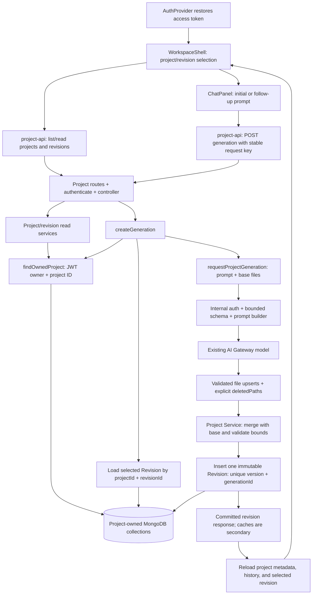

# AgentForge — Project History and Revision Loop: Review Plan

**Reviewed:** 2026-10-10

**Status:** Slices 1–4 backend and Slice 5 frontend history/restoration/follow-up UI are implemented. Core real-service browser checks pass with a deterministic AI fixture; the full automated browser acceptance suite remains outstanding, so M1 is not marked complete.

**Slice 5 progress (2026-10-12):** On the agreed stacked `feature/frontend-project-history` branch (base: `feature/project-service-revision-publication`), the frontend reads real projects/history/selected snapshots, restores validated URL selection after auth, and submits against the visible selected parent. Shell-owned request/prompt state survives responsive remounts; abort/selection guards prevent stale GET data. Stable bounded pending intent is user/project-scoped and explicitly replayed; no generated files or access tokens enter sessionStorage. Committed snapshots survive subsequent metadata reload failure. Truthful empty/loading/error/legacy/A/M/D states replace the demo-file fallback. Backend code, runtime dependencies and production data are untouched. Current checks and remaining gaps are in `08_TESTING_STRATEGY.md`; this is not paid-provider or execution proof. Commit/push were authorized in the subsequent delivery request; PR/merge remain separate actions.

**Slice 4 progress (2026-10-12):** On `feature/project-service-revision-publication`, Project Service loads owned historical bases, captures `H + 1` from actual saved history, persists validated output, then publishes one immutable Revision using existing uniqueness constraints. New revisions store lineage/prompt, A/M/D, model/usage/latency and local manifest-validation metadata; legacy fields remain optional and unknown. Same-key saved-result replay avoids another AI call, distinct-key competing publication returns `REVISION_CONFLICT`, ambiguous writes return `OUTCOME_UNKNOWN`, and post-commit hint failures cannot hide success. A scoped read-only generation GET reports the persisted evidence. No other service, model provider, runtime dependency, normal database index, record migration or infrastructure was changed. Verification is recorded in `08_TESTING_STRATEGY.md`; fixtures prove recovery paths, not real process kills, paid-provider quality or browser E2E. Earlier audit tables and slice updates below are dated historical evidence.

**Progress update (2026-10-12):** Slice 3 adds bounded selected-base context, JSON-escaped prompt construction, complete-content upserts with explicit deletions, independent frontend policy checks, and a pure full-snapshot merge with deterministic A/M/D. Initial generation now persists the locally validated snapshot. Public follow-ups intentionally still return `FOLLOW_UP_NOT_AVAILABLE`; selected-base loading/publication/recovery must be integrated in Slice 4 first. No model/provider/dependency, database schema/index, or frontend change was made. Verification: 24 Project local tests, 14 AI tests, 27 isolated real HTTP/Mongo regressions, plus both service typechecks/builds passed. Real provider output, browser history flow, crash recovery and generated-code builds were not tested. Earlier findings/updates below are historical, not live status.

**Progress update (2026-10-11):** Slice 2 records initial prompt/base/fingerprint/expected-version/request-policy intent, handles exact same-key insert races, and replays saved revision files/version despite stale status or an older pending snapshot. New initial prompts are sent as recorded. Follow-ups remain explicitly gated until their context/merge contract exists. `expectedVersion: 1` is preparatory metadata; revision-counter allocation/publication, saved-result publication recovery, different-key conflict protection, and frontend work remain outstanding. Latest verification: 11 unit tests, 25 isolated Mongo/HTTP/service tests (three consecutive final runs), typecheck and build passed. See the implemented sections in `05_OPENAPI_SPEC.md` and `08_TESTING_STRATEGY.md` for current behavior rather than treating the historical gap table below as live status.

**Request:** The supplied “Next Phase: Project History & Revision Loop” instructions, including the mandatory Section 12 approval gate.

This report uses the M0 audit as a starting point, then rechecks source files and the configured database. Recommendations below are not claims that the feature exists. This document is the only new repository edit in this review.

## 1. Current architecture — verified facts

Root `package.json` defines five npm workspaces:

| Workspace | Actual responsibility | Evidence |
|---|---|---|
| `auth-service` | Register/login, issue access tokens, rotate a hashed refresh token, logout, profile lookup. | `src/routes/auth.routes.ts:14-50`, `src/controller/auth.controller.ts:109-136,224-290`. |
| `project-service` | Verify access tokens, create owned projects, call AI synchronously, store Generation and Revision records. | `src/middlewares/auth.middleware.ts:13-34`, `src/services/project.service.ts:35-54`, `src/services/generation.service.ts:51-131`. |
| `ai-orchestrator-service` | Authenticate the internal caller, validate input, call AI Gateway, validate frontend file output, return usage/model metadata. | `src/app.ts:18-22`, `src/features/generations/generation.service.ts:18-42`. |
| `execution-service` | Status endpoints and middleware foundation. It is outside the current generation flow. | `src/app/app.ts:32-41`; no run route is mounted. |
| `nextjs-boilerplate` | Restore a session, show an authenticated workspace, create projects, submit initial generation, display returned files. | `components/auth/AuthProvider.tsx:41-65`, `components/workspace/ChatPanel.tsx:41-111`, `components/workspace/WorkspaceShell.tsx:25-32`. |

Frontend requests use same-origin Next.js rewrites: `nextjs-boilerplate/next.config.ts:9-19`. These are HTTP proxies, not database access or business logic.

Identity comes from the JWT `sub` claim. Project Service verifies HS256, then assigns `req.user.id`; `ownerId` is not accepted from the browser. Auth and Project currently share the access-token secret. Changing that authentication architecture is outside this phase.

There is no shared contracts package. Types currently exist independently in frontend API helpers, Project models/client schemas, and AI schemas. We will keep that structure and test the contracts, rather than introduce a package migration.

### Database facts checked this turn

A bounded, read-only MongoDB driver probe ran `hello` and `listIndexes` against the configured database. It did not import Mongoose models, create indexes, write records, or print credentials, URIs, or document contents.

- The configured MongoDB is **standalone**. Logical session support is present, but that does not make multi-document transactions available.
- `projects` has `ownerId_1` and `ownerId_1_createdAt_-1` indexes.
- `generations` has an installed **unique** `{projectId: 1, idempotencyKey: 1}` index.
- `revisions` has installed **unique** `generationId` and `{projectId: 1, version: 1}` indexes.
- User records and project/revision contents were not read during the probe.

MongoDB documents single-document atomic writes and unique indexes; standalone deployments do not support multi-document transactions. These facts inform the publication design below. Sources: [atomicity and unique constraints](https://www.mongodb.com/docs/manual/core/write-operations-atomicity/), [transaction availability](https://www.mongodb.com/docs/manual/core/transactions-production-consideration/).

## 2. Current data flow — verified facts

```text
ChatPanel.handleSubmit
  -> lib/project-api.createProject(prompt, accessToken)
  -> POST /api/projects through next.config rewrites
  -> projectRouter -> authenticate -> createProjectController
  -> createProject -> insertProject -> Project collection

Then, for the newly created project:
  -> lib/project-api.generateProject(project.id, accessToken)
  -> POST /api/projects/:projectId/generations (new random key, no body)
  -> authenticate -> createGenerationController -> createGeneration
  -> findOwnedProject + findGenerationByKey
  -> insertPendingGeneration -> Generation collection
  -> setProjectStatus("generating")
  -> requestProjectGeneration({ prompt: project.initialPrompt })
  -> POST /internal/generations + internal token + 90-second timeout
  -> requireInternalToken -> AI createGenerationController
  -> generationRequestSchema.parse -> generateProject
  -> AI SDK generateText + Output.object -> validateManifest
  -> saveGenerationResult
  -> reserveNextRevisionNumber -> insertRevision
  -> markGenerationReady -> setProjectStatus("ready")
  -> HTTP 201 { generation }
  -> WorkspaceShell.showGeneratedFiles -> createWorkspaceFiles
  -> CodeWorkspace -> EditorPanel / ChangesPanel
```

Auth restoration and project restoration are different operations. `AuthProvider` restores a login session after refresh. Nothing currently restores the project or its files.

The current successful generation path is wired in code. This review did not make a paid model request or prove the whole browser flow against a real provider.

## 3. Gap analysis

| Classification | Finding | Exact evidence / effect |
|---|---|---|
| Implemented | Authenticated project creation and owner-scoped generation lookup. | `project.routes.ts:11-16`; `project.repository.ts:17-18`. |
| Implemented | Model output goes through structured schema and path/content validation. | AI `generation.schema.ts:11-78`; four existing tests pass. |
| Partially implemented | Durable revisions. | `revision.model.ts:23-39` stores files and version, but no parent or producing prompt; no revision update path exists today. |
| Partially implemented | Idempotency. | Existing ready result is replayed; pending/failed requests return 409. The insert race is not handled, request payload is not fingerprinted, and replay omits `revisionVersion`. |
| Partially implemented | Error handling. | `generation.service.ts:127-130` maps AI, database, and publication errors to the same 502 and overwrites project status with `failed`. |
| Missing | Project list/read, revision history/read. | `project.routes.ts` mounts only two POST routes; `revision.repository.ts` exports only `insertRevision`. |
| Missing | Targeted follow-up against stored files. | `ChatPanel.tsx:57` always creates a new project; generation always sends `project.initialPrompt` at `generation.service.ts:94`. |
| Missing | Persisted project/revision selection. | `WorkspaceShell.tsx:25-32` stores only temporary files; workspace page reads no IDs. |
| Missing | Genuine empty/loading workspace states. | `CodeWorkspace.tsx:19-20` replaces empty files with demo content. A saved draft would incorrectly appear to contain sample code. |
| Missing | Accurate changed-file metadata. | `createWorkspaceFiles` labels every generated file `A`; UI supports only A/M, not deletion or unchanged files. |
| Missing | Required service, persistence, and browser tests. | Only `generation.schema.test.ts` exists; Project and frontend have no test scripts. |
| Documentation drift | `/api/v1`, queues/202 responses, JWKS, shared packages, and build-validated revisions. | V1 documents describe targets; current routes use `/api/projects`, synchronous 201, shared JWT secrets, independent types, and manifest-only validation. |
| Documentation drift | Revision and prompt limits. | Database design describes 100 files/1 MB/8,000-character prompts; current code permits 12 files/120,000 total characters/1,000-character prompts. |

The M0 roadmap is a proposal, not a fixed implementation requirement. This review refines its suggested transaction/latest-pointer strategy because the database topology and actual installed indexes are now confirmed.

## 4. Dependency map — proposed updated flow



### Action-to-handler map

| Frontend action | API | Controller/service recommendation | Collection reads/writes | Ownership and UI outcome |
|---|---|---|---|---|
| Open workspace / load more projects | GET `/api/projects` | Add `listProjectsController` -> `listProjects` -> project/revision repositories. | Read owner's Projects; batch-read latest Revision metadata for the page. | JWT owner filter before listing; no per-project query loop. |
| Open a saved project | GET `/api/projects/:projectId` | Add `getProjectController` -> `getProject`. | Read owned Project and highest-version Revision metadata. | 404 for nonexistent or another owner's project. |
| Show / paginate history | GET `/api/projects/:projectId/revisions` | Add `listRevisionsController` -> `listProjectRevisions`. | Read owned Project, then that project's Revision summaries. | Files omitted from history list. |
| Select a revision / reload URL | GET `/api/projects/:projectId/revisions/:revisionId` | Add `getRevisionController` -> `getProjectRevision`. | Read owned Project and Revision matching both IDs. | Load persisted files, not local demo data. |
| Create a new project | Existing POST `/api/projects` | Preserve `createProjectController` -> `createProject` -> `insertProject`. | Insert Project. | Existing token-derived owner. Retain the created ID if generation fails. |
| Generate initial/follow-up files | Existing POST generation route, extended body | Extend `createGenerationController` -> `createGeneration` -> AI client and repositories. | Read owned Project/head/base; insert Generation; save output; insert Revision. | Parent belongs to the same project; UI advances only to a committed revision. |
| Read an uncertain/in-flight attempt | GET `/api/projects/:projectId/generations/:generationId` | Add `getGenerationController` -> `getProjectGeneration`. | Read owned Project, scoped Generation, and Revision by generationId. | Committed Revision overrides a stale Generation status; no fabricated progress. |

The extra GET-generation route is a small extension of the documented convention, not an async queue. It helps a browser understand an existing request after a timeout. If the browser never received a generation ID, replaying the same POST key returns either the saved success or a 409 containing that ID.

## 5. Proposed design — API, data, consistency, and frontend

### 5.1 Public contracts

Keep `/api/projects` and the current `{ project }` / `{ generation }` wrappers. Add `{ projects, nextCursor }`, `{ revisions, nextCursor }`, and `{ revision }` for reads. IDs are strings in responses; dates are ISO strings.

| Method/path | Input | Successful response |
|---|---|---|
| POST `/api/projects` | `{ prompt }`, existing 10–1,000-character policy. | 201 `{ project }`. |
| GET `/api/projects` | Validated `limit` (default 20, maximum 50) and opaque `cursor`. | 200 `{ projects, nextCursor }`; summaries include derived latest revision ID/version. |
| GET `/api/projects/:projectId` | Valid MongoDB ID. | 200 `{ project }` with derived latest revision summary; no full file contents. |
| GET `/api/projects/:projectId/revisions` | Valid project ID, `limit`, optional positive `beforeVersion`. | 200 `{ revisions, nextCursor }`, newest first; metadata only. |
| GET `/api/projects/:projectId/revisions/:revisionId` | Valid matching IDs. | 200 `{ revision }` with complete files, parent, prompt, summary, and generation metadata. |
| POST `/api/projects/:projectId/generations` | Header `Idempotency-Key`; initial empty body remains supported; follow-up requires `{ prompt, baseRevisionId }`. | 201 `{ generation }`, complete files and always-present `revisionVersion`, including replays. |
| GET `/api/projects/:projectId/generations/:generationId` | Valid matching IDs. | 200 `{ generation }` with pending/failed metadata or committed ready result. |

An empty initial generation body normalizes to the Project's saved initial prompt and no parent. An explicit initial prompt may be supplied and must be recorded as the actual producing prompt. Once a project has a revision, a new generation requires an explicit base and change prompt. A completed old request is replayed before applying the new-request base requirement.

Browser requests never accept `ownerId`, file contents, a version to reserve, provider credentials, or arbitrary model IDs. Reject unknown body fields, malformed IDs, invalid cursors, and oversized prompts.

Errors retain the existing `message` field and add a stable `code` plus bounded details where needed:

```json
{
  "message": "The project changed while this generation was running.",
  "code": "REVISION_CONFLICT",
  "latestRevisionId": "..."
}
```

- 400: invalid IDs/body/limits or missing base on a new follow-up request.
- 401: missing/invalid access token.
- 404: owned project not found, or revision/generation not in that owned project. Do not reveal that another user's record exists.
- 409: idempotency mismatch, an existing pending/failed attempt, or concurrent revision conflict.
- 502: upstream AI request/output failure.
- 503: persistence outcome cannot yet be established; client preserves its key and reloads/replays.
- 413: request or generated-context/merged-snapshot size exceeds the allowed boundary.

### 5.2 Storage recommendation: full revision snapshots, changed-file output

**Proposed:** Keep each Revision's complete generated file set. The current files are small and bounded, and full snapshots make reopening any revision one indexed read. Delta-only storage would require walking parents and correctly applying deletions before each read.

The snapshot contains the generated frontend files, not the platform repository, node_modules, secrets, or a complete Next.js installation.

For a follow-up, the internal AI request includes:

```json
{
  "requestId": "generation-id",
  "projectId": "owned-project-id",
  "prompt": "Make the hero background darker",
  "template": "nextjs",
  "mode": "economy",
  "baseRevision": {
    "id": "selected-revision-id",
    "version": 1,
    "files": [{ "path": "app/page.tsx", "content": "..." }]
  }
}
```

Project Service loads `baseRevision.files` itself. AI Orchestrator receives only that bounded generated snapshot and the requested change, not all revision history or the service repository.

Keep the AI output's existing `files` array as file **upserts** (complete contents of new/modified files), and add an explicit `deletedPaths` array. An omitted file is preserved. A deletion must be explicit, belong to the base, pass path policy, and not overlap an upsert. This reduces repeated output while making file loss detectable.

Project Service merges that change set with the base and saves the complete resulting snapshot. Public `generation.files` continues to mean the complete files, so the editor and old public response shape remain understandable. New-file paths differing only by case from an existing path are rejected. A no-op or an operation producing an empty project is rejected; it must not create a misleading new revision.

Keep the present limits for this phase: at most 12 final files, 30,000 characters per file, 120,000 total content characters, 120-character paths, and 1,000-character user prompts. Also enforce a serialized internal request-byte bound below the existing 256 KB parser limit; JSON escaping can inflate bytes. Reject oversize input explicitly rather than silently truncating files. Output remains bounded by the current model token cap.

Revalidate base files and merged output under the generated-frontend policy. Historical files that fail the current policy remain viewable, but cannot silently become new AI context. Build/import correctness is not proven by these checks; execution remains a future phase.

### 5.3 Model changes

| Model | Proposed change | Purpose |
|---|---|---|
| `Project` | Keep ownership, name, initial prompt, and existing fields. Add the pagination tie-breaker index only if query explain confirms the need. Treat `currentRevisionNumber` and status as secondary hints. | Avoid making a mutable pointer a second publication authority. |
| `Generation` | Add canonical `sourcePrompt`, nullable `baseRevisionId`, `requestFingerprint`, captured `expectedVersion`, contract/prompt policy version, and completed/failed metadata. Keep saved result and the existing unique key. | Bind one key to one input and preserve validated output for publication retry without another model call. |
| `Revision` | Add nullable `parentRevisionId`, `sourcePrompt`, `fileChanges` (A/M/D), provider/model/usage/latency, manifest-validation policy/result, and `schemaVersion`. | Make each immutable snapshot independently traceable and readable without a per-row Generation lookup. |

New revisions use `parentRevisionId: null` only for initial generation. Metadata says `manifest_validated`, not `build_passed` or `execution_verified`.

Existing records remain readable. Missing historical lineage/prompt fields are marked unknown/legacy; do not invent a parent by assuming the previous version was the base. Usage/model metadata can be projected from an existing linked Generation where available. No destructive migration or collection rewrite is required for this plan.

### 5.4 Publication: one authoritative commit point

**Proposed authority:** A successfully inserted immutable Revision is the generation's commit point. Latest revision is derived by the indexed highest `version` for the project. A persisted `latestRevisionId` is unnecessary in this phase.

1. Authenticate, validate the request, and find the owned project.
2. Normalize prompt/base and resolve any existing idempotent attempt.
3. For a new attempt, load the selected owned base and the current highest revision version `H`. Save `expectedVersion = H + 1` on Generation before calling AI.
4. Insert the pending Generation under the installed unique idempotency index. A racing duplicate rereads the winning attempt; it does not call AI again.
5. Call AI once, validate/merge, and save the complete validated result with the exact base/prompt metadata.
6. Insert one immutable Revision with `version = expectedVersion` and the Generation ID.
7. Handle duplicate `generationId` by rereading the committed revision and replaying it. Handle duplicate `{projectId, version}` from a different Generation as `REVISION_CONFLICT`.
8. Update Generation ready/status and Project counter hints after publication. These are repairable bookkeeping, not the definition of success.
9. Return the committed Revision. If bookkeeping fails after insertion, do not report the generation as definitively failed or overwrite its revision.

**Why this works on the actual database:** the one Revision insert is atomic, and the already-installed unique indexes prevent two different revisions from occupying the same next version or one Generation from producing two revisions. There is no attempt to make several independent writes atomically publish together. The mutable Generation/Project fields must therefore never be the authority used to decide whether a Revision exists.

The current `reserveNextRevisionNumber` flow must stop allocating authoritative versions. A failed generation must not reserve a number or change the latest successful revision. Optional Project-counter repair uses `$max` so a delayed update cannot move backwards.

Project detail/list responses derive latest revision ID/version from Revision records; latest metadata for a list page is batched. A saved revision makes the project usable even if the most recent generation failed. The UI shows generation failure separately from availability of the existing files.

### 5.5 Selected historical bases and concurrency

**Recommendation for approval:** permit any explicitly selected owned base, including an older revision, and clearly display “creating a new revision from vK.” This satisfies selected-base editing without introducing a branch-management UI.

There is one latest published version per project. Version order and parentage have different meanings: v3 may intentionally have v1 as its parent. The service captures the project's current head version independently of the selected parent. If that head changes during the AI call, this attempt conflicts rather than silently publishing against changed project state.

Example: two different keys begin when the latest version is 1. Both capture candidate version 2. One inserts v2; the other receives 409 and inserts no revision. The loser is not automatically reassigned version 3. Both may have consumed model tokens; avoiding that cost would require an admission mechanism beyond this small consistency design.

This refines the M0 “stale base” wording: an intentionally selected historical parent is permitted; an unexpected concurrent change to the captured head is rejected. If linear latest-only editing is preferred during approval, the service can instead require the selected parent to be the head. That is a product policy, not a database limitation.

### 5.6 Idempotency and uncertain outcomes

An idempotency key identifies one logical generation attempt. Fingerprint normalized `{projectId, prompt, baseRevisionId}`; the server supplies owner scope and expected version. The same key with different input returns 409 `IDEMPOTENCY_MISMATCH`.

| State on replay | Behavior |
|---|---|
| Revision exists for the Generation | Return the committed result and version, even if Generation bookkeeping still says pending/failed. |
| Pending, no saved result | Return 409 `GENERATION_IN_PROGRESS` with the attempt ID. Do not start another model call with this key. |
| Pending, validated result saved | Retry publication with the original captured version; do not call the model again. Races converge through the unique indexes. |
| Confirmed terminal AI failure, no revision | Return the stored failure; a deliberate new attempt uses a new key. |
| Different input with existing key | Return 409 and leave the original attempt untouched. |
| Database cannot establish whether insertion succeeded | Return 503 `OUTCOME_UNKNOWN`; retain the key and reconcile through read/replay. Do not equate a lost acknowledgement with a definite failure. |

Legacy Generations do not have fingerprints. Preserve replay for their original empty-body request; reject newly supplied incompatible/ unverifiable payloads rather than fabricate a fingerprint that could accept a different request.

A process crash before Revision insertion can leave a pending attempt. This phase does not promise background completion. Read/replay makes the uncertainty visible; an explicit new attempt can use a new key, and captured-version uniqueness protects history if the original later finishes. A process crash after Revision insertion must be recoverable without another AI call. If bookkeeping recovery also fails, retain the committed Revision as the authority.

Project creation is still a separate request and is not being given a new idempotency scheme. The frontend retains the returned project ID and retries generation on that project; it does not recreate the project just because generation failed. An uncertain creation response is resolved through the saved-project list.

### 5.7 Frontend behavior

- `WorkspaceShell` owns selected project/revision, canonical loaded data, load status, and the current submission state. React state is a view cache of backend data.
- `/workspace?project=<id>&revision=<id>` identifies what to restore. Await page `searchParams` using the installed Next.js convention, pass validated selection strings to the shell, and fetch only after AuthProvider has restored a token. If only project is selected, fetch its actual latest revision.
- The existing left panel shows real saved projects instead of static `recentChats`; history shows stored revision prompts/summaries, not invented chat transcripts.
- New conversation explicitly clears selection and draft state. A prompt in an open project creates a follow-up against the visible selected revision.
- Display project name, selected version, parent, and latest-version distinction. Initial generation failure retains its saved draft; follow-up failure retains the previous loaded files.
- Keep one key per submitted operation and reuse it on transport retry. Minimal pending intent metadata may be kept in user/project-scoped sessionStorage across refresh; saved files and access tokens are never sourced from that storage.
- Cancel/ignore obsolete GET responses when selection changes. A delayed response for project A must never overwrite project B's editor.
- While a submission is running, keep its project/base identity frozen and disable conflicting selection/submission controls. Desktop/mobile layout changes must not reset the submission because its state lives above ChatPanel.
- After success, reload project detail, revision summaries, and the committed selected Revision. If that reload fails, show the returned committed snapshot plus a refresh error; do not mislabel committed generation as failed.
- Saved drafts/no selection have an explicit empty editor. Loading/error screens never display demo files as if they were saved output. Terminal and preview remain correctly labelled as unconnected.
- Changed-file UI distinguishes added/modified/deleted files; unchanged files remain in editor tabs without a fabricated change badge. Deleted paths have no current content and are not editable/selectable as existing files.
- A 401 stops the protected load and asks the user to sign in; reopening from the real project list works after login. Carrying an automatic return URL through AuthForm is optional future UX, not required to change authentication in this phase.

Installed Next.js page and router documentation was read locally. In particular, `searchParams` is asynchronous, and `router.refresh()` alone is not a substitute for refreshing client-fetched revision data.

## 6. File-by-file change plan

Every existing path in the following tables was opened in this review. Names described as “add” are proposed exports, not functions that already exist. Section 6.4 lists proposed new files separately.

### 6.1 Project Service

| Exact existing file | Current responsibility | Proposed change and downstream effect | Dependencies | Tests | Risks |
|---|---|---|---|---|---|
| `project-service/src/routes/project.routes.ts` | Mount two authenticated POST routes. | Add four history GETs and scoped generation-status GET; preserve base URL and auth. | Controller exports, `authenticate`. | HTTP auth, GET contracts, cross-owner access. | Accidentally mounting a read route without auth. |
| `project-service/src/controllers/project.controller.ts` | Forward create/generate and return wrappers. | Forward validated params/query/body to new read functions; pass generation body and key; keep controllers thin. | Project/generation services, AppError. | Status/wrapper/parameter tests. | Express params may be arrays; malformed input must not reach DB. |
| `project-service/src/services/project.service.ts` | Validate prompt/name, create project DTO. | Add owner-scoped list/detail/revision history/detail and serializers; derive latest from Revision. | Project/revision repos; scoped Generation metadata for legacy reads. | Pagination, empty, legacy DTOs, ownership. | Unbounded lists or per-project query loops. |
| `project-service/src/services/generation.service.ts` | Find key, call AI from initial prompt, reserve version, save revision. | Add normalized body/fingerprint, base/head reads, replay recovery, deterministic merge, unique insert publication and precise errors. | All three repos, AI client, file helper. | Parent/files, idempotency races, failures and post-insert recovery. | Changing the authoritative commit point must be done consistently. |
| `project-service/src/repositories/project.repository.ts` | Create/owner lookup/status/counter reservation. | Add paginated owner listing; stop authoritative reservation; make cache updates nondecreasing and secondary. | Project model and read-service serializers. | Owner filters, pagination, cache failure. | An old write path retaining reservation would break the new version rule. |
| `project-service/src/repositories/revision.repository.ts` | Insert only. | Add scoped reads/list/latest, batched latest summaries, and lookup by generationId; insert complete metadata. | Revision model, publication/read services. | Installed uniqueness, atomic competing inserts, lookup scope. | Must not expose revision by ID without first proving project ownership. |
| `project-service/src/repositories/generation.repository.ts` | Key lookup and separate result/status writes. | Store immutable request intent/expected version; catch exact duplicate-key cases; add scoped lookup and conditional bookkeeping updates. | Generation model and Revision recovery. | Same-key race, mismatch, saved-result replay. | Treating every duplicate key as the same conflict would hide valid replays. |
| `project-service/src/models/generation.model.ts` | Pending/ready/failed, key, result, revision reference. | Add request fingerprint/base/prompt/captured version/policy metadata; keep existing unique index. | Generation repos, internal client result, response serialization. | Schema defaults, legacy records, fingerprint persistence. | Old records have no fingerprint; no guessed backfill. |
| `project-service/src/models/revision.model.ts` | Version, project/gen links, summary/files. | Add optional-for-legacy lineage/prompt/change/usage/validation fields and schema version; retain unique indexes. | Revision repo, generation publisher, read DTOs. | Root/parent constraints, immutability, legacy reads. | Do not make missing legacy fields suddenly invalidate existing documents. |
| `project-service/src/clients/ai-orchestrator.client.ts` | Internal token fetch + response schema + 90s timeout. | Send server-loaded base; validate changed-files/deletions/metadata and classify timeout/upstream errors. | AI request/response schemas, generation service. | Fixture HTTP server and timeout/invalid response cases. | Internal `files` becomes upserts, while public `files` must remain a snapshot. |
| `project-service/src/middlewares/error.middleware.ts` | `{message}` errors, invalid JSON, generic 500. | Add optional stable codes/bounded details and explicit body-size errors; log only safe failure metadata. | Services/controllers/frontend API helper. | 400/401/404/409/413/502/503 shapes. | Avoid exposing database/provider messages or file contents. |
| `project-service/package.json` | Dev/typecheck/build/start, no test script. | Add Node-test/tsx scripts split between local tests and database integration tests. | Existing `tsx`; proposed tests. | Run actual scripts. | Integration tests must require a dedicated test DB. |

### 6.2 AI Orchestrator

| Exact existing file | Current responsibility | Proposed change and downstream effect | Dependencies | Tests | Risks |
|---|---|---|---|---|---|
| `ai-orchestrator-service/src/features/generations/generation.schema.ts` | Strict small request; generated files; path/content safety. | Add bounded optional base snapshot and explicit deletions; validate conflicts and context size. | Project client, prompt builder, output validation. | Base limits, deletions, unsafe paths/actions, case conflicts. | Request parser currently rejects a base field; rollout must coordinate contracts. |
| `ai-orchestrator-service/src/features/generations/generation.service.ts` | `generateProject` calls AI Gateway and returns manifest/usage. | Build context from prompt + selected base; request upserts/deletions; return policy metadata. | Schema, proposed prompt helper, existing AI SDK. | Prompt construction and provider-fixture response. | Do not let file text override system instructions or add tools. |
| `ai-orchestrator-service/src/features/generations/generation.schema.test.ts` | Four Node tests. | Extend existing contract/safety tests; keep initial request compatibility. | Schema and existing runner. | Run expanded suite; split route/action tests. | Current combined test does not prove server-action rejection independently of forbidden route rejection. |
| `ai-orchestrator-service/package.json` | Test script selects one schema file. | Include the proposed prompt test file in the same `tsx --test` convention. | Existing test runner. | Run both suites. | No new runtime dependency. |

The AI controller, internal authentication, gateway selection, and JSON parser limits can stay as they are if contract validation remains within those limits. They were inspected, but are not proposed rewrites.

### 6.3 Frontend

| Exact existing file | Current responsibility | Proposed change and downstream effect | Dependencies | Tests | Risks |
|---|---|---|---|---|---|
| `nextjs-boilerplate/lib/project-api.ts` | Create/generate; guards accept only draft Project; helper generates a fresh key internally. | Add history/status reads, Revision/summary DTO guards, typed error codes, caller-supplied stable key/body and AbortSignal support. | Public API schemas, WorkspaceShell. | Valid/invalid responses, HTTP errors, stable-key replay. | Ready projects currently fail `isProject`; broaden status correctly. |
| `nextjs-boilerplate/app/workspace/page.tsx` | Static page wraps RequireAuth/Shell. | Await URL selection params and pass them to Shell; preserve auth wrapper. | Installed Next page API and Shell props. | Refresh/URL validation, production build. | The route becomes request-time rendered when reading searchParams. |
| `nextjs-boilerplate/components/workspace/WorkspaceShell.tsx` | Own session-file state and resizable layout. | Own project/revision/request/load state; load after auth; ignore stale requests; update URL and reload canonical data. | useAuth, API helper, ChatPanel, CodeWorkspace. | Reload, selection race, layout-switch persistence. | Duplication between shell and child state would recreate data-loss bugs. |
| `nextjs-boilerplate/components/workspace/ChatPanel.tsx` | Creates a project per prompt; static recent list; local message array. | Use shell callbacks/data; show real projects/history and selected base; submit initial vs follow-up correctly. | Shell/API DTOs and revision history. | New vs existing project, loading/empty/error/retry. | A retry must not create a second project or change the base/key. |
| `nextjs-boilerplate/components/workspace/CodeWorkspace.tsx` | Fallback demo files; editor/changes shared active path. | Explicit loading/empty/failed-load states; use only selected persisted files; reset active selection per revision. | Shell and panel prop contracts. | Empty saved draft, project/revision switching. | Current `visibleFiles[0]` assumptions fail on genuine empty data. |
| `nextjs-boilerplate/components/workspace/workspace-data.ts` | Demo data and `{path,content}` -> WorkspaceFile adapter, always A. | Adapt persisted fileChanges; represent unchanged files honestly; keep terminal demo labels. | Revision DTOs, EditorPanel/ChangesPanel. | A/M/D/unchanged mapping. | Deleted files have no current snapshot content. |
| `nextjs-boilerplate/components/workspace/EditorPanel.tsx` | Show selected file and A/M badge. | Render change badge only when recorded; support empty selection through parent handling. | WorkspaceFile adapter/CodeWorkspace. | Untouched files and selection behavior. | Avoid claiming every loaded file was newly added. |
| `nextjs-boilerplate/components/workspace/ChangesPanel.tsx` | Show all files as changes. | Show recorded change set; render deleted paths without invalid file-selection actions. | Revision change DTOs and CodeWorkspace. | Deleted/unchanged/no-change display. | A deleted path must not select unrelated fallback content. |
| `nextjs-boilerplate/package.json` | Dev/build/start/lint; no tests. | Add local Node API-helper test script, using built-in type stripping. | Existing Node 22 runtime and proposed test file. | Execute helper tests and lint/build. | Keep alias-dependent UI modules out of the pure Node runner. |

### 6.4 Proposed new files — none exist yet

These names are explicit additions, not inspected existing code:

| Proposed path | Responsibility / dependencies | Tests and risks |
|---|---|---|
| `project-service/src/services/revision-files.ts` | Pure upsert/delete merge and deterministic A/M/D diff; generation service consumes it. | Unit tests must prove unchanged preservation, explicit deletion and size/path conflicts. |
| `project-service/src/services/revision-files.test.ts` | Node tests for the pure file transformation. | No database or provider needed. |
| `project-service/src/services/generation.service.test.ts` | Business-rule tests using narrow test dependencies/fixtures; no production fake-provider mode. | Prove base forwarding, matching fingerprint, failure-before/after-publication and replay behavior. |
| `project-service/src/routes/project.routes.integration.test.ts` | Real HTTP/Mongo tests, including owner separation, pagination and competing inserts. | Requires explicit dedicated test URI; never uses normal service `.env` as a test database. |
| `ai-orchestrator-service/src/features/generations/generation.prompt.ts` | Small pure context/prompt builder so selected-file context can be tested without a provider call. | Bound/escape content; no retrieval engine or generic agent framework. |
| `ai-orchestrator-service/src/features/generations/generation.prompt.test.ts` | Node tests for initial and follow-up prompt construction. | Confirm correct base content and no unrelated history. |
| `nextjs-boilerplate/lib/project-api.test.ts` | Built-in Node tests of API parsing, errors, and exact submitted key/body. | Mock HTTP only; these tests are not evidence of database persistence. |
| `playwright.config.ts` | Configure browser verification against local test services. | Use isolated test data/ports; no paid provider by default. |
| `tests/e2e/project-history.spec.ts` | Browser create/generate/reload/revise/reload, empty/error and selection-race tests. | Separate mocked-transport UI checks from actual backend persistence E2E. |

Existing Auth files, Next rewrites, root workspace layout, Execution Service, environment secrets, Kubernetes manifests, and memory design stay outside the implementation change list.

### 6.5 Tooling and documentation after approval

| Existing path | Proposed change / dependencies | Validation and risk |
|---|---|---|
| `package.json` | Add browser test script and root dev dependency `@playwright/test`. | Needed for real refresh/navigation assertions; lightweight alternative is a documented manual browser checklist, with weaker repeatability. |
| `package-lock.json` | Update only if the approved browser test dependency is installed. | No unrelated package upgrade bundled into history work. |
| `README.md` | Describe real saved-history/follow-up behavior and verification commands only after they work. | Keep execution/preview claims accurate. |
| `docs/04_DATABASE_DESIGN.md` | Add a clearly separated implemented history schema and single-document publication section. | Preserve labelled long-term V1 targets. |
| `docs/05_OPENAPI_SPEC.md` | Document actual `/api/projects` reads, follow-up body, replay, and error semantics. | Check examples against HTTP tests. |
| `docs/10_ADR.md` | Append the accepted storage/publication tradeoff. | Do not rewrite previous decisions. |
| `docs/12_SEQUENCE_DIAGRAMS.md` | Add actual synchronous history/generation/recovery sequences. | Label queue sequence as target state. |
| `docs/AI_ENGINEERING_ROADMAP.md` | Update M1 acceptance wording from mutable pointer/transaction assumptions to the approved authority and selected-base policy. | Do not mark M1 complete before tests pass. |

No packages were added during this review. `@playwright/test` is the only proposed new package; existing Node test/tsx/Mongoose/Zod tools cover backend and contract checks.

## 7. Test plan and acceptance criteria

### Test layers

| Layer | Required cases | External requirements |
|---|---|---|
| Local unit/contract | Prompt/base/body validation; safe merge/delete; snapshot limits; canonical fingerprints; stable API response/error guards; initial request compatibility; replay version present. | Existing Node/tsx; fake non-secret env only where a module requires config. |
| Service tests | Correct base files and producing prompt; existing revisions unchanged; AI failure does not publish; saved-result retry avoids another AI call; cache failure after insert stays successful. | Test-only repository/provider seams; cannot prove real database uniqueness. |
| HTTP/Mongo integration | Owner-only list/read; foreign project/revision/generation 404; pagination; initial and follow-up persistence; installed indexes; same/different key races; ambiguous insert recovery; old-record compatibility. | Dedicated `agentforge_test_*` MongoDB database, local Project API, deterministic AI transport fixture. Standalone MongoDB is sufficient. |
| Browser UI with intercepted transport | Loading/empty/error, disabled submission, exact selected base, stale-response guard, correct deletion badges and failure preservation. | Proposed Playwright package/browser. Clearly label transport as mocked. |
| Browser persistence E2E | Create → v1 → hard refresh → reopen → follow-up → v2 → hard refresh → read v1/v2; login restoration and selected URL; generation failures keep v1 files. | Real Next/Auth/Project, isolated MongoDB, AI transport fixture; no paid key. |
| Optional provider smoke | One bounded real follow-up and inspect that selected base influenced changed files. | Explicit test provider credentials and a low budget; report separately. Not required for deterministic safety tests. |

No Docker or Redis is required for this history phase's chosen database design. Test fixtures must not introduce a fake provider into the production app. One test composition can replace the provider network boundary, while the actual Project API and MongoDB persistence remain real.

### Mandatory acceptance cases

1. Project creation yields a draft owned by JWT identity; initial generation stores exactly one complete revision.
2. Refresh restores the login session and reloads the project/revision from the backend.
3. Revision history is paginated, ordered, and contains metadata without repeating full file content.
4. Revision 2 has the selected revision 1 as parent, the follow-up prompt, complete merged files, truthful model/usage/validation metadata and A/M/D changes.
5. The AI request includes the selected base files; no original-prompt-only regeneration occurs for follow-ups.
6. Unchanged files are preserved; deletion requires explicit validated intent; v1 contents do not change.
7. Cross-owner projects return 404; foreign-project revisions/generations also return 404; unauthorized requests return 401.
8. Replaying a key returns the same committed revision and version with no extra AI call; changing the payload under that key returns 409.
9. Concurrent same-key requests create one Generation and at most one Revision. The in-flight duplicate may receive documented 409; after completion every replay returns the winner.
10. Concurrent different-key requests that observed the same head yield one publication and one clear revision conflict, rather than silently becoming sequential edits.
11. Failure before Revision insertion leaves all successful revisions and derived latest selection untouched.
12. Failure after Revision insertion is reconciled as committed success through read/replay; stale bookkeeping does not hide files or trigger another paid call.
13. Changing projects or resizing across mobile/desktop boundaries cannot apply stale files or reset an in-flight request's identity.
14. Legacy revisions remain viewable with unknown provenance explicitly labelled.
15. All relevant unit/contract/integration/browser suites, frontend lint/build, and affected service typechecks/builds actually run and pass. Record separately any unrun provider smoke.

### Checks actually run during this planning turn

| Check | Actual result |
|---|---|
| `npm run typecheck --workspace=project-service` | Passed, exit 0. |
| `npm run test --workspace=ai-orchestrator-service` | Passed, 4/4 existing tests. |
| `npm run typecheck --workspace=ai-orchestrator-service` | Passed, exit 0. |
| `npm run lint --workspace=nextjs-boilerplate` | Passed, exit 0. |
| Bounded MongoDB `hello` and index inspection | Connected; standalone topology; key/version/generation uniqueness confirmed. |
| `git diff --name-only` before the report | Empty; application and tracked config remained unchanged. |

These are baseline checks, not acceptance evidence for the proposed feature. No history APIs, new tests, browser flow, provider call, migration, dependency install, full production build, or transaction test was run in this turn. M0 build/audit results are historical evidence in the existing audit, not reverified results of this turn.

## 8. Risks and tradeoffs

| Decision | Benefit | Limitation / control |
|---|---|---|
| Full snapshots in Revision | Simple reliable reads and immutable recovery. | Repeated storage; bounded small manifests justify it now. Delta storage can be revisited from measured size. |
| Changed-file model output | Preserves omitted files and reduces repeated output tokens. | Merge/deletion rules become an explicit tested contract; Project Service owns the complete snapshot. |
| Revision insert is the commit point | Fits standalone MongoDB and existing uniqueness constraints; no new infrastructure. | All read/replay paths must stop trusting mutable status/counter fields as success authority. |
| Optimistic version publication | No long database transaction or application lock around a 90-second external call. | Concurrent competing calls can both incur provider cost; one is rejected at publication. |
| Allow an explicitly selected older parent | Matches selected-base editing and supports intentional restoration. | Linear version number is not the same as lineage; show parent clearly and do not invent ancestry. |
| Lazy legacy compatibility | Avoids an unsafe backfill or broken old records. | Some old prompt/parent metadata stays unknown; do not claim complete historical traceability. |
| Synchronous generation for this phase | Preserves current service contract and learning scope. | Crashes before publication can leave unknown/pending work; durable execution/retries are deferred. |
| Small test seams and one browser test dependency | Reproducible critical-flow evidence. | Fixture-only tests do not verify provider quality; keep integration and browser persistence checks separate. |

The M0 security/dependency findings are still relevant release concerns, but this turn did not rerun dependency audit or authorize dependency remediation. Auth hardening, queueing, sandbox execution, memory, embeddings, Obsidian, MCP, skills orchestration, multiple agents, and platform deployment remain outside this plan.

## 9. Implementation order after approval

1. **Read contracts and safety first:** add owner-scoped history DTOs, repository reads, controller routes, and legacy serialization; verify real Mongo ownership/pagination tests.
2. **Define request identity:** add canonical prompt/base/fingerprint and captured-version fields, fix ready-replay version, and add duplicate-key tests before changing model calls.
3. **Define the file-change boundary:** add bounded base-context and deletion contracts, pure prompt construction and merge/diff tests; keep initial-generation compatibility.
4. **Publish revisions reliably:** change generation orchestration to save result then insert one immutable Revision; verify concurrent inserts, foreign bases, failure timing and read/replay recovery.
5. **Connect the existing UI:** lift identity/state to WorkspaceShell, load saved projects/revisions from URL/backend, wire selected-base follow-up, and remove misleading demo fallback for real drafts.
6. **Prove the whole loop:** run local/service/Mongo tests, then deterministic browser persistence E2E; run affected builds/lint and document every unverified external check.
7. **Update implementation documentation:** record the approved decision and actual contracts, then mark completed acceptance items only with evidence.

Estimated scope is approximately 34–42 files across application changes, new test/helper files, test tooling, and focused documentation updates. This is more precise than the initial M0 estimate because empty states, deletion handling, replay recovery, and browser verification are now traced. Work should be delivered in the small slices above, not a single large rewrite. A history-list helper component is optional and should be added only if ChatPanel readability warrants it.

**Original planning approval gate (historical):** The review stopped before application changes. Slices 1–5 were later authorized separately. Remaining automated browser verification is the next review slice; no queue, execution, auth redesign or memory work is authorized by the history work. Service-scoped branches and later explicit commit/PR/merge steps are documented in `GIT_WORKFLOW.md`.
